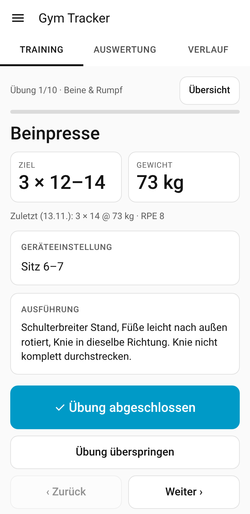
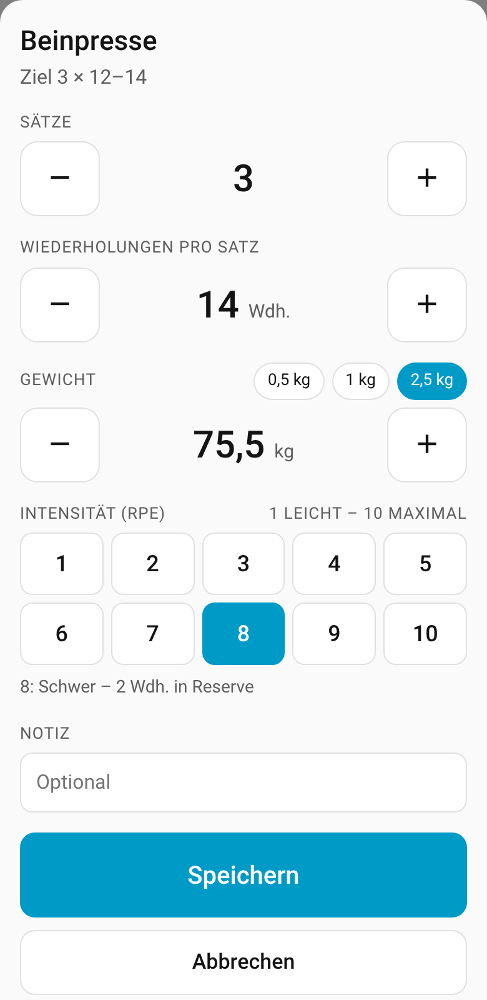
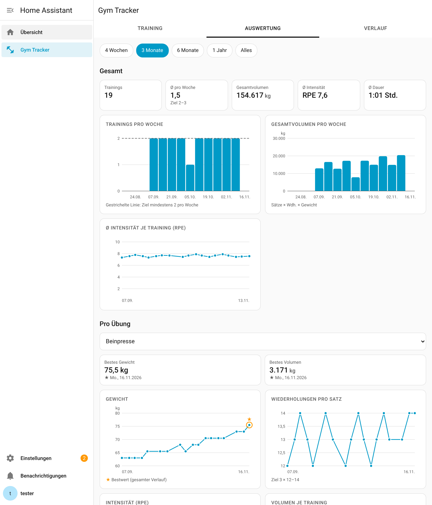
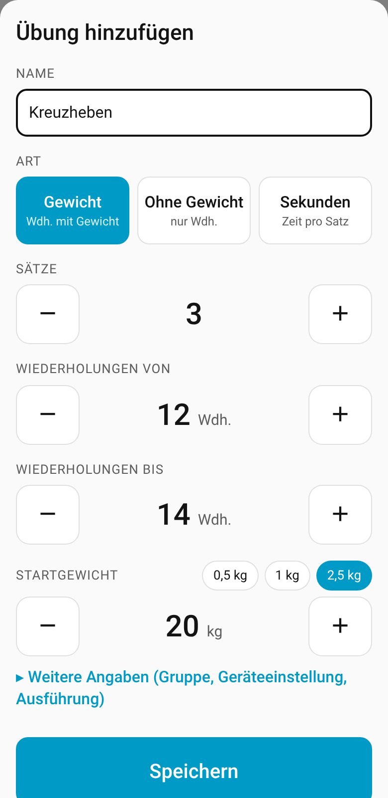

# Gym Tracker für Home Assistant

Eine Trainings-App als Home-Assistant-Integration mit eigenem Panel in der Seitenleiste.
Sie führt Übung für Übung durch das Krafttraining, erfasst nach jeder Übung Sätze,
Wiederholungen, Gewicht und Intensität und zeigt die Entwicklung über Wochen und Monate
in Diagrammen. Gedacht für das Smartphone im Studio (HA Companion App), die Auswertung
funktioniert genauso auf Tablet und Desktop.

<p>
  
  
  
  
</p>



Die Screenshots zeigen Beispieldaten.

## Funktionen

- **Geführtes Training**: Warm-up, dann pro Übung ein Bildschirm mit Ziel, aktuellem Gewicht,
  Geräteeinstellung und Ausführungshinweis.
- **Schnelle Erfassung** mit großen +/−-Tasten: Sätze, Wiederholungen bzw. Sekunden, Gewicht
  (Schritte 0,5 / 1 / 2,5 kg) und Intensität (RPE 1–10).
- **Gewichtslogik**: Beim ersten Training gilt das Gewicht aus dem Plan, danach immer das
  zuletzt erfasste Gewicht der Übung.
- **Überspringen, Reihenfolge ändern, Fortsetzen**: Übungen lassen sich überspringen oder über
  die Übersicht in beliebiger Reihenfolge erledigen. Eine laufende Einheit bleibt erhalten,
  auch wenn die App zwischendurch geschlossen wird.
- **Plan bearbeiten** direkt im Panel: Übungen hinzufügen, ändern, innerhalb ihrer Gruppe
  verschieben (↑/↓), ganze Gruppen verschieben, archivieren und wiederherstellen.
- **Spontane Übung** während des Trainings (z. B. wenn ein Gerät belegt ist) – beim Beenden
  entscheidest du, ob sie in den Plan übernommen wird.
- **Zusammenfassung** am Ende: Dauer, Gesamtvolumen, Intensität und Gewichtsänderungen.
- **Auswertung** für 4 Wochen, 3 Monate, 6 Monate, 1 Jahr oder alles: Trainings pro Woche/Monat,
  Gesamtvolumen, durchschnittliche Intensität sowie pro Übung Gewicht, Wiederholungen, RPE und
  Volumen – Bestwerte sind mit ★ markiert.
- **Verlauf** aller Einheiten: Einträge nachträglich bearbeiten, nachtragen oder löschen,
  CSV-Export aller Daten.
- **Sensoren** fürs Dashboard: letztes Training, Trainings diese Woche, Trainings diesen Monat.
- Oberfläche auf Deutsch, Hell-/Dunkelmodus folgt dem Home-Assistant-Theme, keine
  CDN-Abhängigkeiten.

## Voraussetzungen

- Home Assistant 2025.11 oder neuer
- [HACS](https://hacs.xyz), wenn die Installation als benutzerdefiniertes Repository erfolgen soll

## Installation über HACS

1. HACS öffnen → Menü oben rechts → **Benutzerdefinierte Repositories**.
2. `https://github.com/evilgrin09/haos-fitness-training-tracker` eintragen, Typ **Integration**,
   hinzufügen.
3. In HACS nach **Gym Tracker** suchen und herunterladen.
4. Home Assistant neu starten.
5. **Einstellungen → Geräte & Dienste → Integration hinzufügen → Gym Tracker**.
   Dabei lässt sich festlegen, ob und unter welchem Titel das Panel in der Seitenleiste erscheint.

Manuell geht es auch: den Ordner `custom_components/gym_tracker` nach
`/config/custom_components/` kopieren und Home Assistant neu starten.

Bei der Ersteinrichtung wird der Plan „Ganzkörper-Training“ (10 Übungen, 2–3× pro Woche)
automatisch angelegt.

## Bedienung

1. **Training starten** – das Warm-up abhaken.
2. Übung ausführen, dann **Übung abgeschlossen** antippen. Die Eingabe ist mit den Sollwerten
   vorbelegt (Ziel-Sätze, oberes Ende der Wiederholungsspanne, aktuelles Gewicht); meist ist nur
   die Intensität zu wählen.
3. Über **Übersicht** lässt sich jede Übung direkt anspringen und das Training beenden.
4. Unter **Auswertung** und **Verlauf** finden sich Diagramme, vergangene Einheiten und der
   CSV-Export.

Die Intensität (RPE) beschreibt, wie anstrengend die Übung war: 10 = keine Wiederholung mehr
möglich, 8 = zwei Wiederholungen in Reserve, 5 = viele Wiederholungen wären noch möglich.

### Plan bearbeiten

<p>
  
  
</p>

Auf dem Startbildschirm führt **Plan bearbeiten** zur Planübersicht. Während eines laufenden
Trainings ist der Plan gesperrt.

- **Hinzufügen**: Name, Art (Gewicht / Ohne Gewicht / Sekunden), Sätze und je nach Art
  Wiederholungsspanne, Dauer oder Startgewicht. Gruppe, Geräteeinstellung und Ausführungshinweis
  stehen unter „Weitere Angaben“. Die Übung kommt ans Ende ihrer Gruppe, ohne Gruppe ans Ende
  des Plans.
- **Bearbeiten**: Übung antippen. Änderungen gelten ab dem nächsten Training, vergangene Einträge
  bleiben unverändert. Die Art lässt sich nicht mehr ändern, sobald es Einträge gibt. Ein neues
  Startgewicht greift nur, solange noch kein Gewicht erfasst wurde.
- **Verschieben**: ↑/↓ an der Übung verschiebt innerhalb der Gruppe, ↑/↓ an der Gruppenüberschrift
  die ganze Gruppe. Übungen ohne Gruppe stehen immer am Ende.
- **Archivieren**: Die Übung verschwindet aus dem Training, Verlauf, Auswertung und CSV-Export
  behalten alle Einträge (dort als „archiviert“ gekennzeichnet). Unter „Archivierte Übungen“ lässt
  sie sich wiederherstellen. Tippst du beim Hinzufügen den Namen einer archivierten Übung, wird
  sie zum Wiederherstellen vorgeschlagen, statt doppelt angelegt zu werden.

### Spontane Übung

In der **Übersicht** der laufenden Einheit fügt **+ Übung hinzufügen** eine Übung nur für dieses
Training hinzu – neu angelegt oder aus dem Archiv. Beim Beenden fragt die App „In den Plan
übernehmen?“: Bei Ja wird sie eine normale Planübung, bei Nein (und bei abgebrochenem Training)
bleibt sie archiviert; der Eintrag bleibt in Verlauf und Auswertung.

### Wie gezählt wird

- Wochen laufen von Montag bis Sonntag, in der Zeitzone von Home Assistant.
- Sensoren und Gesamtstatistik zählen nur **abgeschlossene** Einheiten. Abgebrochene Einheiten
  bleiben mit ihren Einträgen im Verlauf und zählen für das „zuletzt erfasste Gewicht“.
- Volumen = Sätze × Wiederholungen × Gewicht. Übungen ohne Gewicht gehen nicht ins Volumen ein.
- Wird ein Training erst lange nach der letzten Übung beendet (mehr als zwei Stunden), gilt die
  letzte erfasste Übung als Ende der Einheit.

## Sensoren

| Sensor | Inhalt |
|---|---|
| Letztes Training | Datum der letzten abgeschlossenen Einheit |
| Trainings diese Woche | Anzahl seit Montag, Attribute `target_min` / `target_max` aus dem Plan |
| Trainings diesen Monat | Anzahl im laufenden Kalendermonat |

## Daten und Backup

Alle Daten liegen in der SQLite-Datei `/config/gym_tracker.db` – unabhängig vom Recorder, also
ohne Löschfrist, und in jedem Home-Assistant-Backup enthalten. Die Datei bleibt auch erhalten,
wenn die Integration entfernt wird; wer die Daten wirklich löschen will, löscht die Datei von Hand.

Der CSV-Export (Verlauf → **CSV exportieren**) enthält eine Zeile pro Satz, mit Semikolon als
Trennzeichen und Dezimalkomma, sodass Excel die Datei direkt öffnet. Die letzte Spalte
„Archiviert“ zeigt, ob die Übung noch Teil des Plans ist.

Beim Update auf eine neue Version wird die Datenbank automatisch und ohne Datenverlust
angepasst.

## Entwicklung

```bash
pip install -r requirements_test.txt
pytest -q
node --check custom_components/gym_tracker/frontend/gym-tracker-panel.js
```

- `db.py` – SQLite-Schema, Migrationen (`PRAGMA user_version`) und alle Abfragen, ohne
  Home-Assistant-Abhängigkeit
- `logic.py` – Gewichtslogik, Volumen, Bestwerte, Zeiträume, CSV
- `store.py` – führt Datenbankzugriffe im Executor aus (nicht im Event-Loop)
- `websocket.py` – API für das Panel
- `frontend/gym-tracker-panel.js` – Panel als Webcomponent ohne Build-Schritt, Diagramme als SVG

## Geplante Ausbaustufen

Das Datenmodell ist darauf vorbereitet, gebaut ist davon noch nichts:

- Mehrere Pläne, Plan-Stammdaten (Name, Zielhäufigkeit, Warm-up) im Panel bearbeiten
- Satzpausen-Timer mit Benachrichtigung
- Steigerungsvorschlag, wenn die Wiederholungsspanne bei niedriger Intensität geschafft wurde
- Offline-Erfassung im Studio mit späterer Synchronisierung
- Wiederholungen je Satz einzeln erfassen (die Datenbank speichert bereits eine Zeile pro Satz)

## Probleme und Wünsche

Fehler und Ideen bitte als [Issue](https://github.com/evilgrin09/haos-fitness-training-tracker/issues) melden.

## Lizenz

[MIT](LICENSE)
