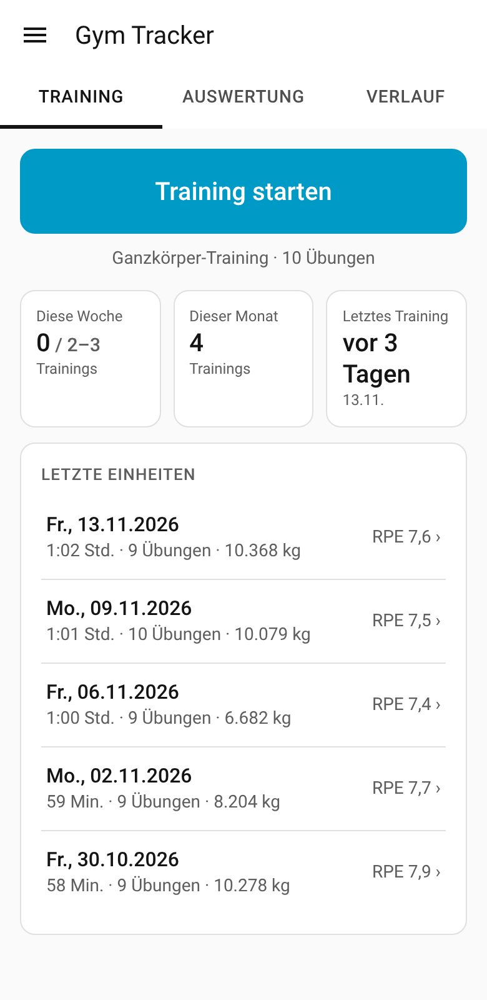
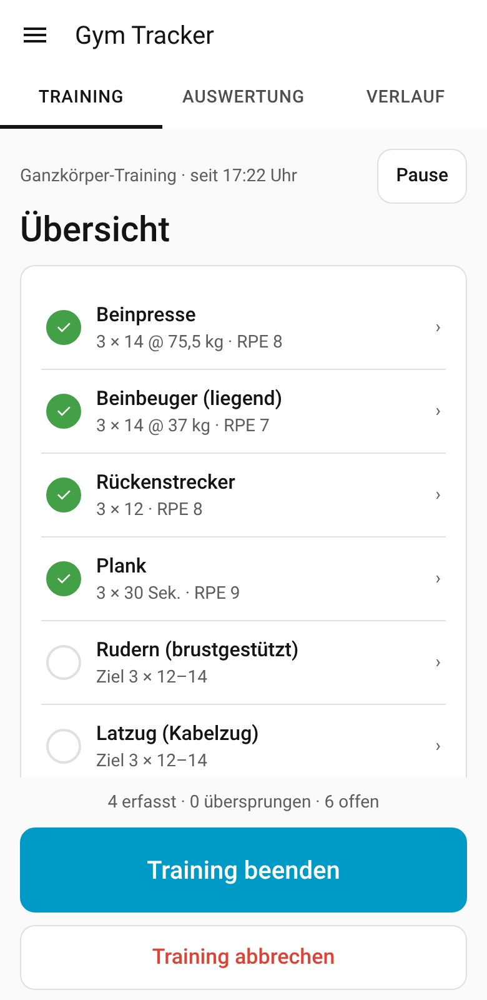
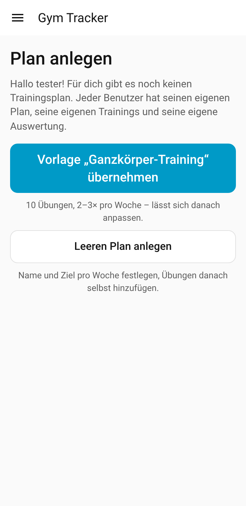
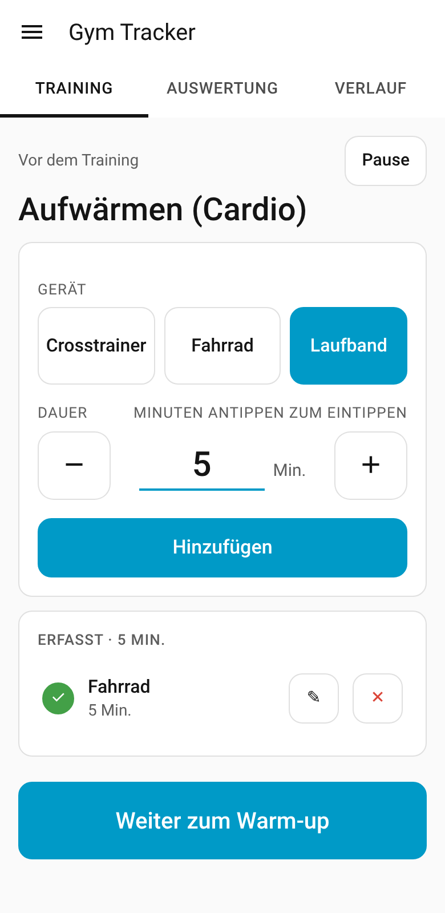
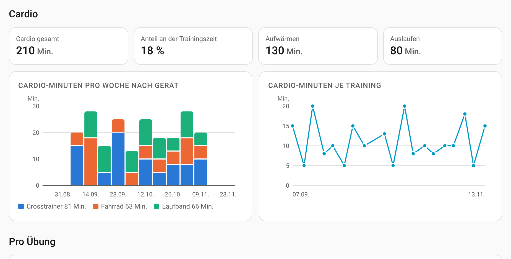
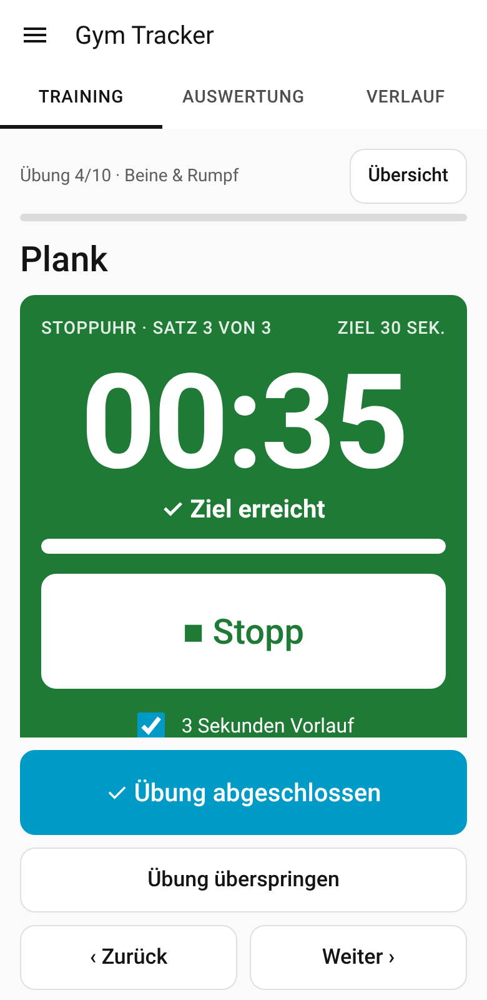
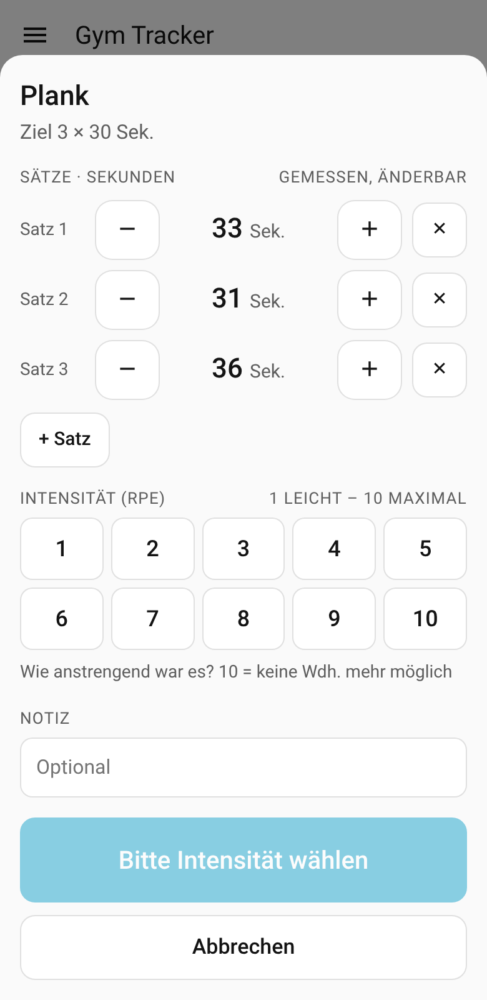
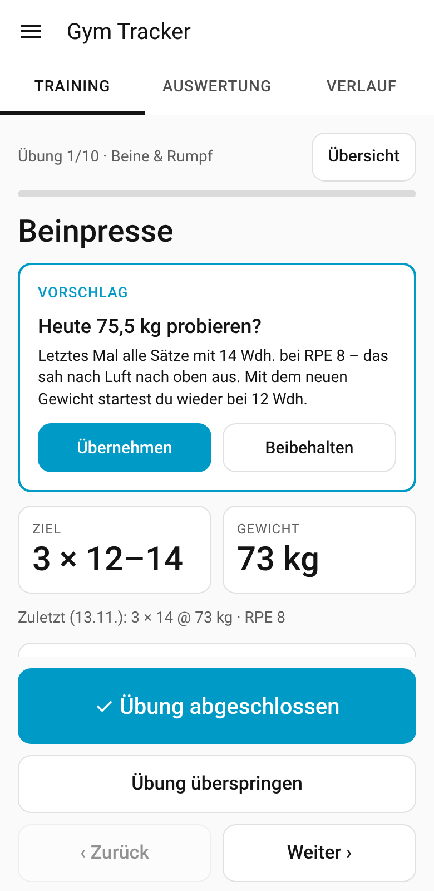
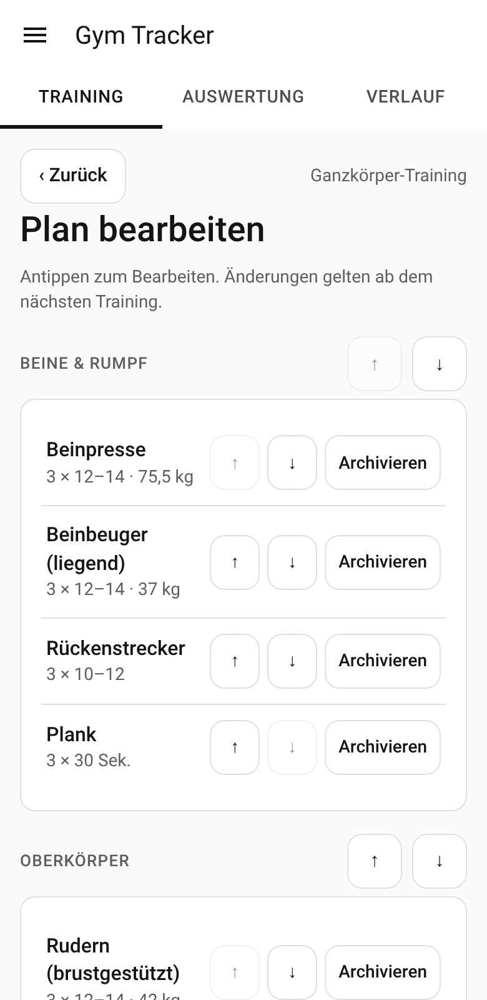

# Gym Tracker für Home Assistant

Eine Trainings-App als Home-Assistant-Integration mit eigenem Panel in der Seitenleiste.
Sie führt Übung für Übung durch das Krafttraining, erfasst nach jeder Übung Sätze,
Wiederholungen, Gewicht und Intensität und zeigt die Entwicklung über Wochen und Monate
in Diagrammen. Gedacht für das Smartphone im Studio (HA Companion App), die Auswertung
funktioniert genauso auf Tablet und Desktop.

<p>
  
  
  
  
</p>


Die Screenshots zeigen Beispieldaten.

## Funktionen

- **Mehrere Benutzer**: Jeder Home-Assistant-Benutzer hat seinen eigenen Plan, seine eigenen
  Trainings, Auswertungen und Sensoren. Wer das Panel nutzen darf, lässt sich einschränken.
- **Geführtes Training**: Cardio zum Aufwärmen, Warm-up, dann pro Übung ein Bildschirm mit Ziel,
  aktuellem Gewicht, Geräteeinstellung und Ausführungshinweis, zum Schluss Cardio zum Auslaufen.
- **Schnelle Erfassung** mit großen +/−-Tasten: Sätze, Wiederholungen bzw. Sekunden, Gewicht
  (Schritte 0,5 / 1 / 2,5 kg) und Intensität (RPE 1–10).
- **Vorbelegung**: Beim ersten Training gelten Startgewicht, unteres Ende der Spanne bzw. Sollzeit
  aus dem Plan, danach immer die zuletzt erfassten Werte der Übung (bei Zeitübungen die Zeit, die
  in allen Sätzen gehalten wurde).
- **Steigerungsvorschläge**: Wurde die Spanne bei niedriger Intensität geschafft, schlägt die App
  z. B. „Heute 65,5 kg probieren?“ vor – übernehmen oder beibehalten. Bei Stillstand gibt es
  Hinweise, bei hoher Anstrengung den Rat, Ausführung, Schlaf und Erholung zu prüfen.
- **Cardio**: Crosstrainer, Fahrrad oder Laufband in Minuten, beim Aufwärmen und Auslaufen,
  auch mehrere Geräte nacheinander.
- **Stoppuhr für Zeitübungen** (z. B. Plank): große, aus der Entfernung lesbare Zeit, optionaler
  3-Sekunden-Vorlauf, rein optische Rückmeldung bei erreichtem Ziel, jeder Satz wird einzeln gemessen.
- **Überspringen, Reihenfolge ändern, Fortsetzen**: Übungen lassen sich überspringen oder über
  die Übersicht in beliebiger Reihenfolge erledigen. Eine laufende Einheit bleibt erhalten,
  auch wenn die App zwischendurch geschlossen wird.
- **Plan bearbeiten** direkt im Panel: Übungen hinzufügen, ändern, innerhalb ihrer Gruppe
  verschieben (↑/↓), ganze Gruppen verschieben, archivieren und wiederherstellen.
- **Spontane Übung** während des Trainings (z. B. wenn ein Gerät belegt ist) – beim Beenden
  entscheidest du, ob sie in den Plan übernommen wird.
- **Zusammenfassung** am Ende: Dauer, Gesamtvolumen, Intensität, Cardio-Minuten,
  Gewichtsänderungen und Hinweise zur Entwicklung.
- **Auswertung** für 4 Wochen, 3 Monate, 6 Monate, 1 Jahr oder alles: Trainings pro Woche/Monat,
  Gesamtvolumen, durchschnittliche Intensität, Cardio nach Gerät und Phase sowie pro Übung
  Gewicht, Wiederholungen, RPE und Volumen – Bestwerte sind mit ★ markiert.
- **Verlauf** aller Einheiten: Einträge nachträglich bearbeiten, nachtragen oder löschen,
  CSV-Export aller Daten.
- **Sensoren** fürs Dashboard, pro Benutzer: letztes Training, Trainings diese Woche, Trainings
  diesen Monat, Cardio-Minuten diese Woche.
- Oberfläche auf Deutsch, Hell-/Dunkelmodus folgt dem Home-Assistant-Theme, keine
  CDN-Abhängigkeiten.

## Voraussetzungen

- Home Assistant 2025.11 oder neuer
- [HACS](https://hacs.xyz), wenn die Installation als benutzerdefiniertes Repository erfolgen soll

## Installation über HACS

1. HACS öffnen → Menü oben rechts → **Benutzerdefinierte Repositories**.
2. `https://github.com/evilgrin09/haos-fitness-training-tracker` eintragen, Typ **Integration**,
   hinzufügen.
3. In HACS nach **Gym Tracker** suchen und herunterladen.
4. Home Assistant neu starten.
5. **Einstellungen → Geräte & Dienste → Integration hinzufügen → Gym Tracker**.
   Dabei lässt sich festlegen, ob und unter welchem Titel das Panel in der Seitenleiste erscheint.

Manuell geht es auch: den Ordner `custom_components/gym_tracker` nach
`/config/custom_components/` kopieren und Home Assistant neu starten.

Beim ersten Öffnen des Panels legt jeder Benutzer seinen Plan an: als Kopie der Vorlage
„Ganzkörper-Training“ (10 Übungen, 2–3× pro Woche) oder als leeren Plan mit Name und Ziel pro Woche.

## Mehrbenutzer

<p>
  
</p>

- Gym Tracker erkennt am angemeldeten Home-Assistant-Benutzer, wer das Panel nutzt. Jeder sieht
  und bearbeitet nur seine eigenen Pläne, Trainings, Auswertungen, seinen Verlauf und CSV-Export –
  das gilt auch für Admins.
- Laufende Trainings, die Sperre der Planbearbeitung und spontane Übungen gelten pro Benutzer.
- **Erlaubte Benutzer**: Unter **Einstellungen → Geräte & Dienste → Gym Tracker → Konfigurieren**
  lässt sich festlegen, wer Gym Tracker nutzen darf. Leer = alle. Andere Benutzer sehen nur den
  Hinweis „Kein Zugriff“; die Integration weist ihre Anfragen auch serverseitig ab. Das Panel
  bleibt in deren Seitenleiste sichtbar, weil Home Assistant Panels nicht pro Benutzer ausblendet.

## Update von Version 0.2.x

Beim ersten Start nach dem Update passiert automatisch:

1. **Sicherung**: Die bisherige Datenbank wird nach `/config/gym_tracker.db.bak-0.2.1` kopiert
   (der Pfad steht im Log). Eine vorhandene Sicherung wird nie überschrieben.
2. **Datenbank-Update** ohne Datenverlust: Benutzerzuordnung, Cardio und Empfehlungen kommen hinzu.
3. **Zuordnung der bisherigen Daten**: Plan, Übungen, Trainings und Einträge gehören dem
   Home-Assistant-Benutzer **tim-mobile** (gesucht über Anzeige- oder Benutzername). Gibt es ihn
   nicht genau einmal, wird nichts geraten: Die Daten bleiben unverändert, aber unzugeordnet.
   Admins sehen dann im Panel einen Hinweis und wählen den Besitzer unter **Konfigurieren →
   „Bestehende Daten zuordnen an“** (angeboten werden nur Benutzer ohne eigenen Plan). Meldet sich
   tim-mobile erst später zum ersten Mal an, werden die Daten dabei automatisch zugeordnet.
4. **Sensoren**: Die bisherigen drei Sensoren behalten ihre entity_ids und gehören jetzt dem
   Besitzer der bisherigen Daten, Dashboards und Automationen funktionieren weiter.

Zum Zurückkehren auf 0.2.1: Integration auf 0.2.1 zurücksetzen und die Sicherung zurück nach
`/config/gym_tracker.db` kopieren.

## Bedienung

1. **Training starten** – Cardio zum Aufwärmen erfassen oder überspringen, dann das Warm-up abhaken.
2. Übung ausführen, dann **Übung abgeschlossen** antippen. Die Eingabe ist mit den zuletzt
   erfassten Werten vorbelegt (Ziel-Sätze, Wiederholungen bzw. Sekunden, Gewicht); die Intensität
   muss jedes Mal gewählt werden.
3. Nach der letzten Übung folgt Cardio zum Auslaufen (überspringbar).
4. Über **Übersicht** lässt sich jede Übung und jeder Cardio-Schritt direkt anspringen und das
   Training beenden – auch ohne Cardio.
5. Unter **Auswertung** und **Verlauf** finden sich Diagramme, vergangene Einheiten und der
   CSV-Export.

Die Intensität (RPE) beschreibt, wie anstrengend die Übung war: 10 = keine Wiederholung mehr
möglich, 8 = zwei Wiederholungen in Reserve, 5 = viele Wiederholungen wären noch möglich.

### Cardio

<p>
  
</p>

Gerät antippen (Crosstrainer, Fahrrad, Laufband), Minuten mit +/− einstellen oder eintippen,
**Hinzufügen**. Mehrere Einträge pro Schritt sind möglich, z. B. 5 Min. Fahrrad und 5 Min.
Laufband; ✎ ändert, ✕ löscht einen Eintrag. Es gibt bewusst keine Vorbelegung und keine Ziele.
Im Verlauf lässt sich Cardio nachtragen und bearbeiten.

Cardio zählt zur Trainingsdauer, aber **nicht** zu Volumen, Intensität, Bestwerten oder
Steigerungsvorschlägen. Die Auswertung zeigt Minuten pro Woche bzw. Monat nach Gerät, den Verlauf
je Training, die Aufteilung auf Aufwärmen und Auslaufen und den Anteil an der Trainingszeit.



### Stoppuhr für Zeitübungen

<p>
  
  
</p>

Bei Übungen der Art „Sekunden“ steht oben auf dem Übungsbildschirm eine Stoppuhr:

- **Start** antippen – mit eingeschaltetem **3 Sekunden Vorlauf** zählt die Uhr erst 3-2-1 herunter,
  damit du in Position gehen kannst. Der Vorlauf ist standardmäßig an; die Einstellung wird pro
  Benutzer gespeichert und gilt auf allen Geräten.
- Der Balken läuft bis zur Zielzeit. Ist sie erreicht, wird die ganze Karte grün, blinkt einmal
  kurz auf und zeigt „Ziel erreicht“; die Uhr läuft weiter. Es gibt bewusst **keinen Ton und keine
  Vibration**. Bei „Bewegung reduzieren“ im Betriebssystem entfällt das Blinken.
- Zielzeit ist die Sollzeit aus dem Plan; wurde heute ein „+5 Sek.“-Vorschlag übernommen, dessen Wert.
- **Stopp** übernimmt die Zeit (auf ganze Sekunden gerundet) als Satz. Gemessene Sätze stehen unter
  der Uhr und lassen sich mit ✕ löschen, z. B. nach einem Fehlstart.
- Nach dem letzten Ziel-Satz – oder jederzeit mit **Übung abgeschlossen** – öffnet sich die Eingabe
  mit einer Zeile pro gemessenem Satz; die Werte bleiben änderbar. Gespeichert wird jeder Satz einzeln.
- Solange die Uhr läuft, bleibt der Bildschirm an (wo der Browser das unterstützt). Die Zeit wird aus
  Zeitstempeln berechnet; App-Wechsel, Bildschirmsperre oder Neuladen verfälschen sie nicht, und
  eine laufende Messung samt Sätzen wird nach dem Neuladen fortgesetzt.
- Die Stoppuhr ist optional: Wer sie nicht nutzt, erfasst wie bisher Sätze × Sekunden.

Bei unterschiedlichen Zeiten pro Satz zeigt der Verlauf z. B. „33 / 31 / 36 Sek.“, das Diagramm
„Dauer pro Satz“ den Durchschnitt; der Bestwert ist der längste Satz.

### Steigerungsvorschläge

<p>
  
</p>

Beim Start eines Trainings prüft die App für jede Übung die bisherigen Einheiten und zeigt
höchstens einen Vorschlag auf dem Übungsbildschirm. **Übernehmen** passt die Vorbelegung für
dieses Training an, **Beibehalten** blendet den Vorschlag bis zum nächsten Training aus. Vorschläge
und Entscheidungen stehen im Verlauf.

| Situation in der letzten Einheit | Vorschlag |
|---|---|
| Alle Sätze am oberen Ende der Spanne, RPE ≤ 8 | Gewicht + 2,5 kg (unter 10 kg: + 1 kg), Wdh. wieder am unteren Ende |
| Zweimal in Folge am oberen Ende, RPE ≤ 6 | doppelter Gewichtsschritt |
| Unter dem oberen Ende, RPE ≤ 7 | 1–2 Wdh. mehr versuchen |
| Zeitübung: Sollzeit in allen Sätzen erreicht, RPE ≤ 7 | + 5 Sekunden, ausgehend vom kürzesten Satz |
| Ohne Gewicht über dem oberen Ende | Hinweis: Zusatzgewicht oder langsamere Ausführung |
| Stillstand, Ø RPE ≤ 7, Übung mit 2 Ziel-Sätzen | einen Satz mehr (ändert den Plan dauerhaft) |
| Stillstand, Ø RPE ≤ 7 | Hinweis zum Steigern |
| Stillstand, Ø RPE ≥ 9 | kein Steigerungsvorschlag, Hinweis: Ausführung, Schlaf und Erholung prüfen |

- Vorschläge gibt es erst ab zwei abgeschlossenen Einheiten der Übung. Übersprungene Übungen und
  abgebrochene Trainings zählen nicht.
- Ist die Vorbelegung schon gleich oder höher als der Vorschlag (z. B. weil in einem abgebrochenen
  Training bereits mit dem höheren Gewicht trainiert wurde), entfällt der Vorschlag.
- **Stillstand** heißt: in den letzten 4 Wochen oder in den letzten 6 Einheiten (was zuerst
  erreicht ist) keine Steigerung bei Gewicht, Wiederholungen oder Zeit. Stillstands-Hinweise
  stehen auch in der Zusammenfassung und in der Auswertung bei der Übung.
- Alle Schwellwerte stehen als Konstanten in `logic.py`.

### Plan bearbeiten

<p>
  
  
</p>

Auf dem Startbildschirm führt **Plan bearbeiten** zur Planübersicht. Während eines laufenden
Trainings ist der Plan gesperrt.

- **Hinzufügen**: Name, Art (Gewicht / Ohne Gewicht / Sekunden), Sätze und je nach Art
  Wiederholungsspanne, Dauer oder Startgewicht. Gruppe, Geräteeinstellung und Ausführungshinweis
  stehen unter „Weitere Angaben“. Die Übung kommt ans Ende ihrer Gruppe, ohne Gruppe ans Ende
  des Plans.
- **Bearbeiten**: Übung antippen. Änderungen gelten ab dem nächsten Training, vergangene Einträge
  bleiben unverändert. Die Art lässt sich nicht mehr ändern, sobald es Einträge gibt. Ein neues
  Startgewicht greift nur, solange noch kein Gewicht erfasst wurde.
- **Verschieben**: ↑/↓ an der Übung verschiebt innerhalb der Gruppe, ↑/↓ an der Gruppenüberschrift
  die ganze Gruppe. Übungen ohne Gruppe stehen immer am Ende.
- **Archivieren**: Die Übung verschwindet aus dem Training, Verlauf, Auswertung und CSV-Export
  behalten alle Einträge (dort als „archiviert“ gekennzeichnet). Unter „Archivierte Übungen“ lässt
  sie sich wiederherstellen. Tippst du beim Hinzufügen den Namen einer archivierten Übung, wird
  sie zum Wiederherstellen vorgeschlagen, statt doppelt angelegt zu werden.

### Spontane Übung

In der **Übersicht** der laufenden Einheit fügt **+ Übung hinzufügen** eine Übung nur für dieses
Training hinzu – neu angelegt oder aus dem Archiv. Beim Beenden fragt die App „In den Plan
übernehmen?“: Bei Ja wird sie eine normale Planübung, bei Nein (und bei abgebrochenem Training)
bleibt sie archiviert; der Eintrag bleibt in Verlauf und Auswertung.

### Wie gezählt wird

- Wochen laufen von Montag bis Sonntag, in der Zeitzone von Home Assistant.
- Sensoren und Gesamtstatistik zählen nur **abgeschlossene** Einheiten; eine Einheit nur mit
  Cardio zählt als Training. Abgebrochene Einheiten
  bleiben mit ihren Einträgen im Verlauf und zählen für das „zuletzt erfasste Gewicht“.
- Volumen = Sätze × Wiederholungen × Gewicht. Übungen ohne Gewicht gehen nicht ins Volumen ein.
- Wird ein Training erst lange nach der letzten Übung beendet (mehr als zwei Stunden), gilt die
  letzte erfasste Übung als Ende der Einheit.

## Sensoren

Jeder Benutzer mit Plan bekommt ein eigenes Gerät „Gym Tracker <Name>“ mit diesen Sensoren,
z. B. `sensor.gym_tracker_anna_trainings_diese_woche`:

| Sensor | Inhalt |
|---|---|
| Letztes Training | Datum der letzten abgeschlossenen Einheit |
| Trainings diese Woche | Anzahl seit Montag, Attribute `target_min` / `target_max` aus dem Plan |
| Trainings diesen Monat | Anzahl im laufenden Kalendermonat |
| Cardio-Minuten diese Woche | Cardio-Minuten der abgeschlossenen Einheiten seit Montag |

Ausnahme: Der Besitzer der Daten aus 0.2.x behält die bisherigen entity_ids
`sensor.gym_tracker_letztes_training`, `sensor.gym_tracker_trainings_diese_woche` und
`sensor.gym_tracker_trainings_diesen_monat`. Sein neuer Cardio-Sensor heißt
`sensor.gym_tracker_tim_mobile_cardio_minuten_diese_woche`.

## Daten und Backup

Alle Daten liegen in der SQLite-Datei `/config/gym_tracker.db` – unabhängig vom Recorder, also
ohne Löschfrist, und in jedem Home-Assistant-Backup enthalten. Die Datei bleibt auch erhalten,
wenn die Integration entfernt wird; wer die Daten wirklich löschen will, löscht die Datei von Hand.

Der CSV-Export (Verlauf → **CSV exportieren**) enthält die Daten des angemeldeten Benutzers:
eine Zeile pro Satz und eigene Zeilen für Cardio (Übung „Cardio“ mit den Spalten
„Cardio-Phase“, „Gerät“ und „Minuten“), mit Semikolon als Trennzeichen und Dezimalkomma, sodass
Excel die Datei direkt öffnet. Die Spalte „Archiviert“ zeigt, ob die Übung noch Teil des Plans ist.

Beim Update auf eine neue Version wird die Datenbank automatisch und ohne Datenverlust angepasst;
vorher legt die Integration eine Sicherung `gym_tracker.db.bak-<alte Version>` an.

## Entwicklung

```bash
pip install -r requirements_test.txt
pytest -q
node --check custom_components/gym_tracker/frontend/gym-tracker-panel.js
```

- `db.py` – SQLite-Schema, Migrationen (`PRAGMA user_version`) und alle Abfragen, ohne
  Home-Assistant-Abhängigkeit
- `logic.py` – Vorbelegung, Steigerungsregeln mit ihren Schwellwerten, Volumen, Bestwerte,
  Cardio-Auswertung, Zeiträume, CSV
- `store.py` – führt Datenbankzugriffe im Executor aus (nicht im Event-Loop), ordnet Daten aus
  0.2.x zu, prüft erlaubte Benutzer
- `websocket.py` – API für das Panel; jeder Befehl arbeitet nur mit den Daten des anfragenden
  Benutzers
- `frontend/gym-tracker-panel.js` – Panel als Webcomponent ohne Build-Schritt, Diagramme als SVG

## Geplante Ausbaustufen

Das Datenmodell ist darauf vorbereitet, gebaut ist davon noch nichts:

- Mehrere Pläne pro Benutzer, Plan-Stammdaten (Name, Zielhäufigkeit, Warm-up) im Panel bearbeiten
- Satzpausen-Timer mit Benachrichtigung
- Offline-Erfassung im Studio mit späterer Synchronisierung (Einträge und Cardio haben bereits
  vom Gerät erzeugte IDs, doppelt gesendete Einträge werden erkannt)
- Wiederholungen je Satz einzeln erfassen (die Datenbank speichert bereits eine Zeile pro Satz);
  die Steigerungsregeln werten dann automatisch den schwächsten Satz aus

## Probleme und Wünsche

Fehler und Ideen bitte als [Issue](https://github.com/evilgrin09/haos-fitness-training-tracker/issues) melden.

## Lizenz

[MIT](LICENSE)
